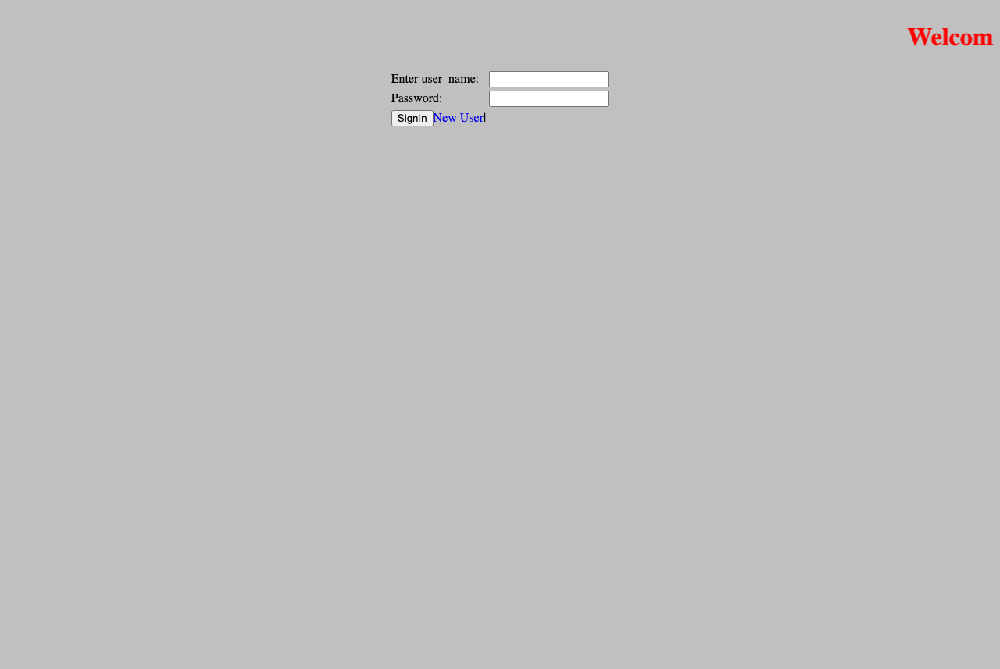
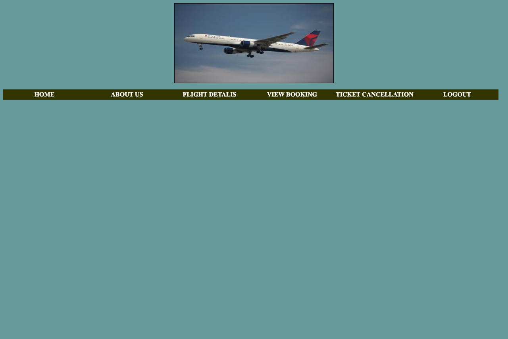
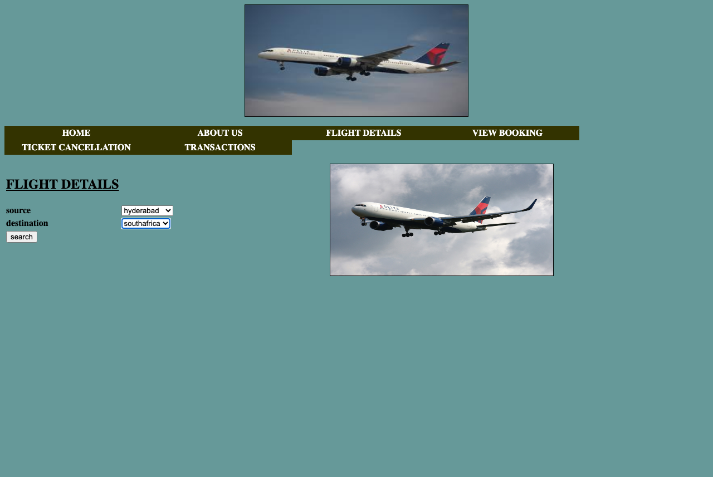
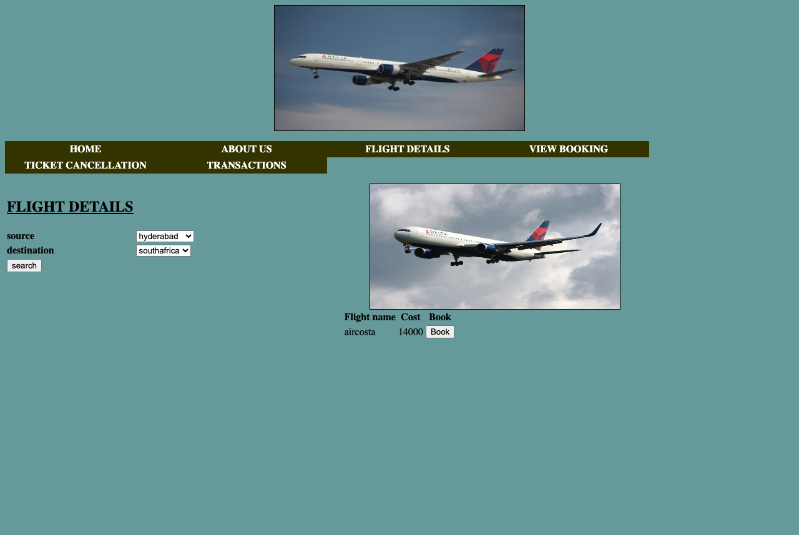
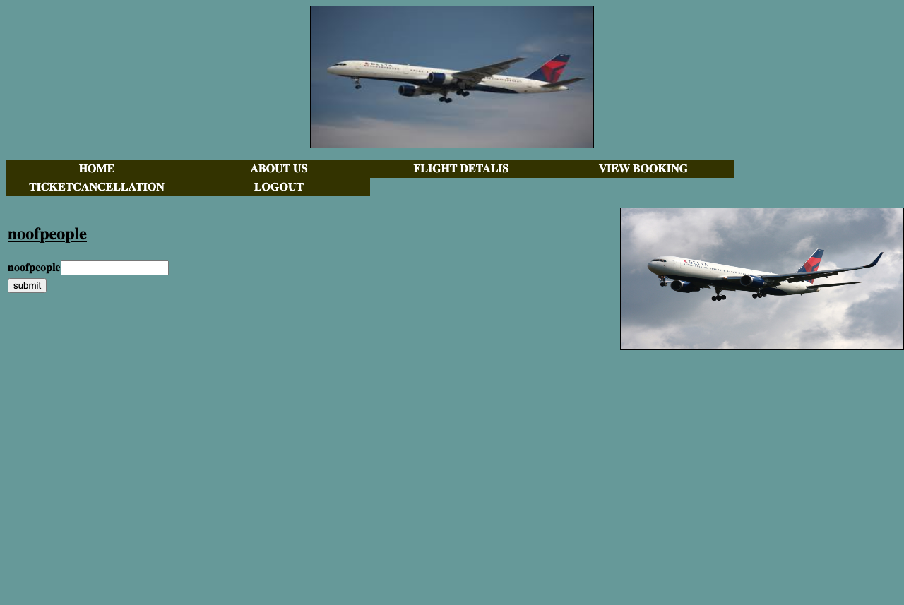
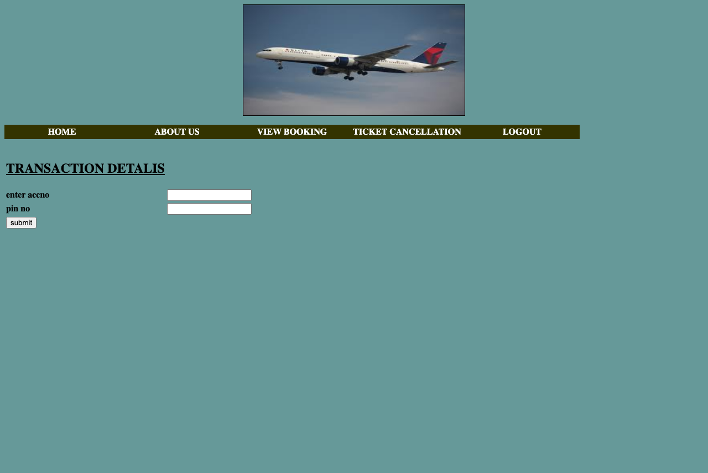
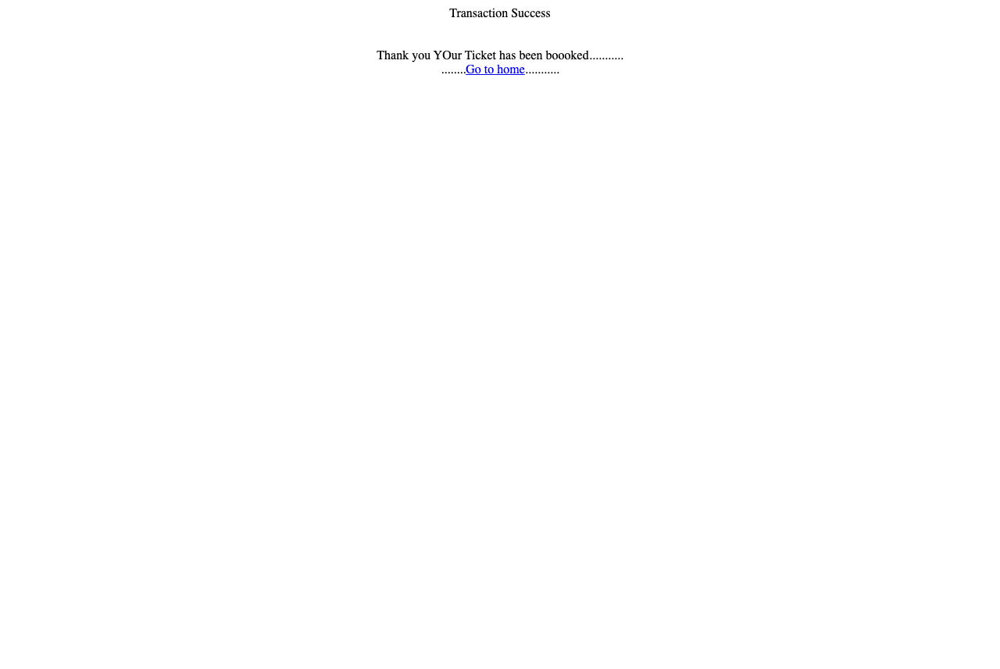
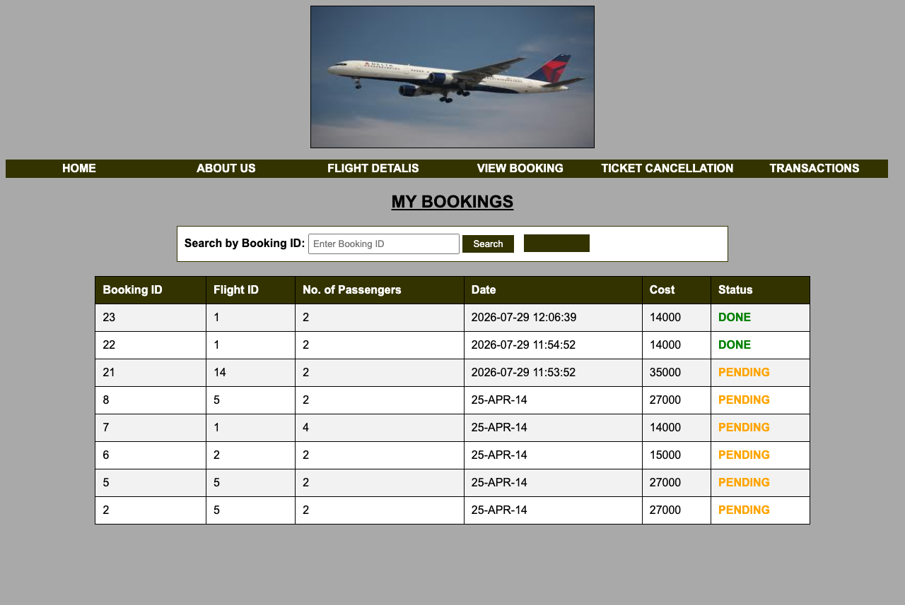
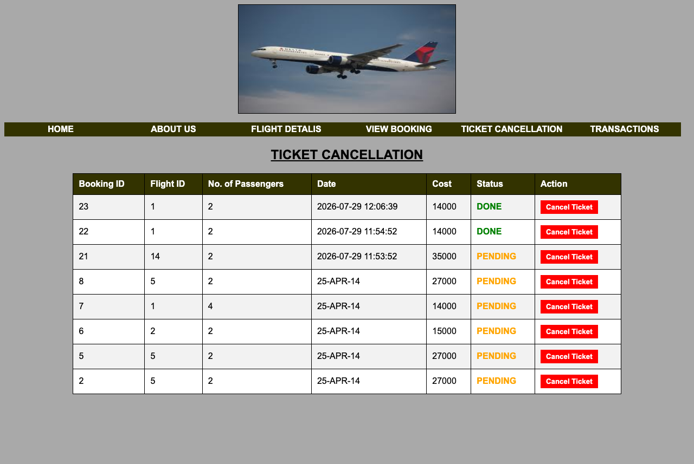
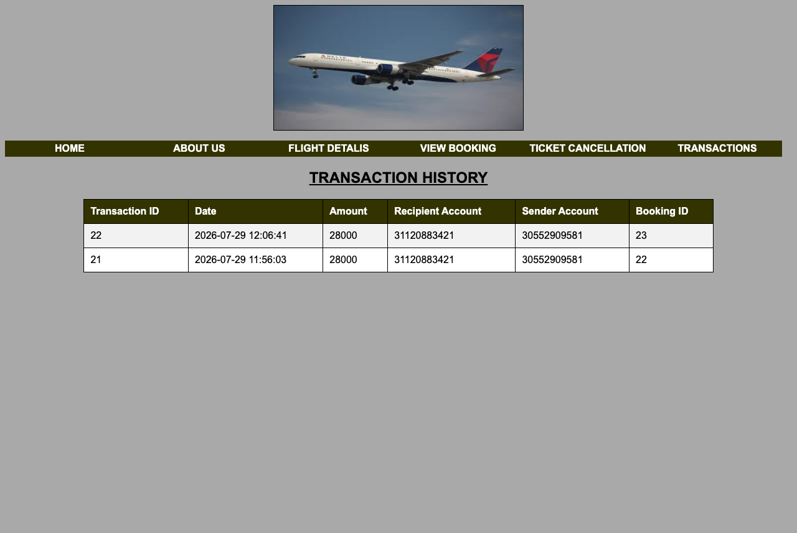

# Airline Reservation System

A complete J2EE web application for airline seat reservations, flight searching, booking management, ticket cancellation, and transaction processing.

## 🚀 Key Improvements & Bug Fixes

We have upgraded this application from the original codebase to fix several critical bugs and adapt it for running easily on modern local setups:

1. **Database Migration to H2**: Ported the database layer from Oracle XE (heavy local setup) to H2 in Oracle Compatibility Mode. It runs automatically in-process and doesn't require setting up standalone database servers.
2. **Auto-commit Transaction Bug**: Fixed a database transaction commit bug where seat booking and balances reverted to original states because `con.commit()` was never called on successful bookings.
3. **Flight Search Selection Persistence**: Migrated the static flight search page to a dynamic JSP (`flightdetalis.jsp`), allowing dropdown choices to persist and preventing page loads from resetting airport dropdown lists.
4. **Complete Database Seeding**: Seeded flights for every single route combination available in the airport dropdown lists, so every search successfully displays flight details and costs.
5. **View Booking Management**: Replaced the static booking lookup mockup with a dynamic search page (`viewbooking.jsp`) showing booking status, dates, and number of passengers.
6. **Ticket Cancellation & Refunds**: Implemented the ticket cancellation page (`ticketcancellation.jsp`) and refund handler (`cancelTicket.jsp`) to cancel bookings, transfer funds back from the airline merchant account to the passenger's bank account, and log the transaction.
7. **Transaction History Viewer**: Created a dynamic transaction viewer (`viewtransactions.jsp`) showing payment logs (Sender, Recipient, Amount, Booking ID).

---

## 🛠️ Tech Stack & Language Support

- **Backend Logic**: Java (Servlets)
- **Dynamic Views**: JSP (JavaServer Pages)
- **Frontend Pages**: HTML5, CSS3, JavaScript (AJAX / XMLHttpRequests)
- **Database**: H2 Database (Oracle SQL dialect compatibility mode)
- **Server**: Apache Tomcat 9.0+

---

## 🏃 How to Run Locally

### Prerequisites
- Java Development Kit (JDK 8 or higher)
- Apache Tomcat (9.0 recommended)

### Deployment Steps
1. Copy the bundled `airlinereservation1.war` file into your Tomcat's `webapps/` folder.
2. Start the Tomcat server:
   ```bash
   ./bin/startup.sh
   ```
3. Open your browser and navigate to:
   `http://localhost:8080/airlinereservation/login.html`

---

## 🔑 Pre-populated Test Accounts

### User Login Credentials
- **Username**: `nav@gmail.com`
- **Password**: `nav`

### Payment Bank Accounts & PINs
- **Merchant Account** (Receives funds): `31120883421` (r.teja)
- **User Accounts** (To pay with):
  - Account `30552909581` | PIN `5879` (y.saikrishna) — *Available: 2,000,000*
  - Account `33540765663` | PIN `3721` (t.srinivas) — *Available: 3,000,000*
  - Account `30345439612` | PIN `4690` (m.ganesh) — *Available: 4,000,000*

---

## 🖼️ Application Walkthrough & Demo Screenshots

Below is the step-by-step process of the running web application, captured during a live transaction:

### 1. Login Page


### 2. Home Dashboard


### 3. Flight Search Page

*(Selections: Source: Hyderabad | Destination: South Africa)*


### 4. Search Results & Flight List


### 5. Passenger Selection


### 6. Secure Bank Payment


### 7. Booking Success Confirmation


### 8. Dynamic Booking History (My Bookings)


### 9. Interactive Ticket Cancellation


### 10. Live Transaction Audit Logs

